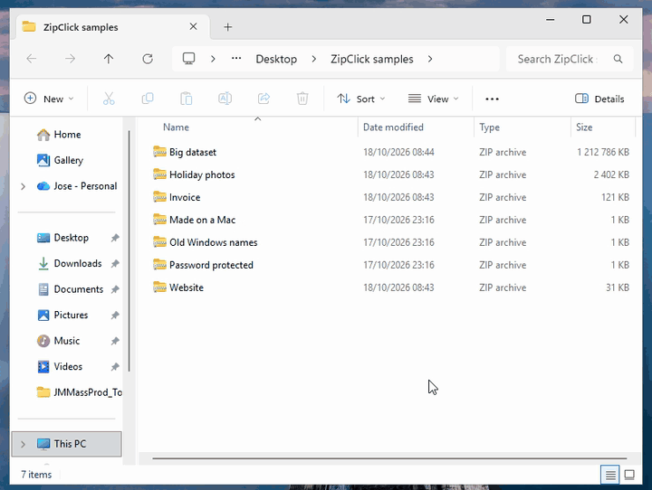

# ZipClick

ZipClick makes double-clicking a .zip, .rar, .7z or .tar.gz file on Windows extract it, the way it works on a Mac.



On Windows, double-clicking a zip opens it like a folder. To get the files out you right-click, choose Extract All, confirm where they should go, and then deal with the second window that opens. With ZipClick the double-click puts the files next to the zip and you carry on.

Website: https://onaips.github.io/zipclick/

## Install

Download [ZipClick.exe](https://github.com/oNaiPs/zipclick/releases/latest/download/ZipClick.exe) and run it ([ARM64 build](https://github.com/oNaiPs/zipclick/releases/latest/download/ZipClick-arm64.exe) for Snapdragon PCs). It installs for your user only, without admin rights, and then opens the Default apps page in Settings, where you pick ZipClick for .zip files. Windows doesn't let a program make itself the default, so that click has to be yours.

The other types are on the same Settings page. If you leave them, Windows asks the first time you open a .rar or .7z which app to use: choose ZipClick, then Always.

The exe isn't code-signed yet, so SmartScreen warns the first time you run it. Click More info, then Run anyway.

To remove it, go to Settings > Apps > Installed apps, find ZipClick and choose Uninstall.

## What happens when you double-click

If the archive holds a single folder or file, that item appears next to the archive. If it holds several things, they go into a new folder named after the archive. Nothing is ever overwritten: if the name is taken you get "Photos 2", then "Photos 3".

If the archive has a password, ZipClick asks for it, and asks again if it's wrong. The new item is selected in the Explorer window you were using. A big archive shows a small progress window with a Cancel button. Cancelling leaves nothing behind, because ZipClick extracts into a hidden folder and only renames it into place once everything is written.

Zips made on a Mac come without the `__MACOSX` folder and `.DS_Store` files. Zips from older Windows versions, which store names in the old DOS code page, come out with their accents intact.

The dialogs follow your Windows display language. ZipClick speaks English, Portuguese (Portugal and Brazil), Spanish, French, German and Italian.

## Formats

ZipClick reads .zip (including password-protected ones, ZipCrypto or AES, and the Deflate64, BZip2 and LZMA methods), .7z, .rar (RAR 5 and older, multi-part archives too), .tar on its own or compressed as .tar.gz, .tgz, .tar.bz2, .tar.xz and .tar.zst, and single files compressed with gzip, bzip2, xz or zstd. It goes by what's inside the file, not by its extension.

## Limits

.7z, .xz and .rar archives extract several times slower than 7-Zip, because their decoders are written in Go and use one core: 1 GB of files in a .7z takes about 18 seconds instead of 3. Zip, gzip and zstd are close to the native tools, and .zip is faster than Windows' own Extract All. The [benchmark page](https://onaips.github.io/zipclick/benchmark.html) has the numbers against 7-Zip, WinRAR, Bandizip and Windows, and `bench/` has the scripts.

Symbolic links inside an archive are skipped. Self-extracting .exe archives aren't handled.

ZipClick always leaves 1 GB free on the drive. An archive that would need more stops with a "not enough free space" message, which is also what stops a decompression bomb, a few KB that unpack into gigabytes.

You can still look inside a zip without extracting it: right-click it, then Open with > File Explorer.

## Command line

```
zipclick ARCHIVE...    extract
zipclick install       install for this user
zipclick uninstall     remove
zipclick status        show where double-clicks on each type go right now
--quiet                no dialogs, messages go to stdout and stderr
--password=PW          the password, instead of asking for it (other programs you run can see it)
```

Set `ZIPCLICK_LANG` (for example `pt-PT`) to force a language.

## Code signing policy

Status: pending. ZipClick has applied to the SignPath Foundation's free code signing program; until it is approved, releases are not signed.

Free code signing provided by [SignPath.io](https://about.signpath.io), certificate by [SignPath Foundation](https://signpath.org).

Committers and reviewers: [Jose Pereira](https://github.com/oNaiPs). Approvers: [Jose Pereira](https://github.com/oNaiPs).

Releases are built by GitHub Actions from the tagged source and signed only after I approve each one in SignPath.

Privacy policy: this program will not transfer any information to other networked systems unless specifically requested by the user or the person installing or operating it. ZipClick has no network code at all.

## Building

You need Go. It cross-compiles from any OS.

```
./check.sh          # gofmt, go vet, staticcheck, govulncheck and the tests, as CI runs them
./build.sh 0.4.1    # writes dist/zipclick-amd64.exe and dist/zipclick-arm64.exe
```

A release is a tag: `git tag -a v0.5.0 -m "what changed"` and `git push origin v0.5.0`. The workflow in `.github/workflows/release.yml` tests, builds, sends both executables to SignPath and drafts the GitHub release with the signed files and the tag message as notes. Approve the signing request in SignPath, check the draft, publish it.

The archives the tests use are in `testdata/`, made by `testdata/make.sh`. The icon, manifest and version info live in `winres/`. `build.sh` regenerates `rsrc_windows_*.syso` from them with go-winres, and `go build` embeds those.

I test releases on Windows 11 25H2 (x64), clicking through the install, the Settings step, every archive in the test suite, upgrade and uninstall.

The formats come from [bodgit/sevenzip](https://github.com/bodgit/sevenzip), [nwaples/rardecode](https://github.com/nwaples/rardecode), [klauspost/compress](https://github.com/klauspost/compress) and [ulikunitz/xz](https://github.com/ulikunitz/xz). The Deflate64 decoder is Go's own inflate with Deflate64's three changes, in `internal/deflate64`.

ZipClick is built with the help of AI coding agents (LLMs). I review the changes and test each release myself.

## License

MIT. See [LICENSE](LICENSE).
